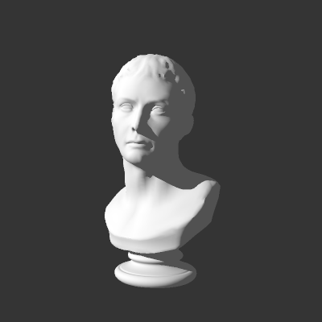
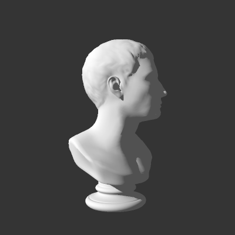
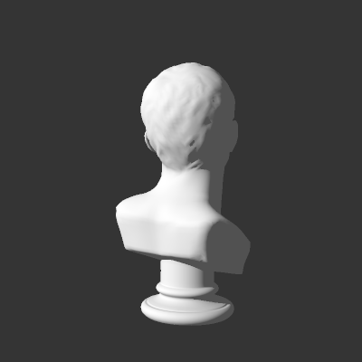
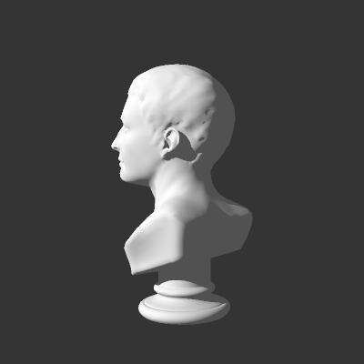
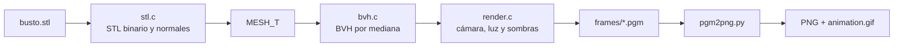

<div align="center">
  <h1>STL Raytracer</h1>
  <p>Raytracer en C99 que lee un STL binario, construye un BVH y genera una<br>
  animación turntable de 120 frames con iluminación difusa y sombras duras.</p>
  <p>
    <a href="https://github.com/juandrodriguezf/stl-raytracer/actions/workflows/build.yml"></a>
    
    
    
    
  </p>
  
</div>

## Vistas del modelo

| 0° | 90° | 180° | 270° |
|:---:|:---:|:---:|:---:|
|  |  |  |  |

## Requisitos

- gcc con soporte para C99 (probado con MinGW-w64 13.2.0).
- Python 3.10 o superior con Pillow:
  `python -m pip install -r requirements.txt`.
- PowerShell en Windows para ejecutar los scripts de conveniencia.

## Compilar y ejecutar

La forma más rápida es:

```powershell
.\run.ps1
```

El script compila, limpia las salidas anteriores, renderiza los 120 frames y
convierte los PGM a PNG y GIF.

También se puede hacer paso a paso:

```powershell
.\build.ps1
.\raytracer.exe -i busto.stl -o frames -n 120 -w 400 -H 400 -s 2
python pgm2png.py frames png --gif animation.gif --fps 30
```

Con `mingw32-make`:

```powershell
mingw32-make
mingw32-make clean
```

## Opciones del renderizador

| Opción | Valor por defecto | Descripción |
| --- | --- | --- |
| `-i` | `busto.stl` | STL binario de entrada. |
| `-o` | `frames` | Carpeta donde se escriben los PGM. |
| `-n` | `120` | Número de frames de la vuelta completa. |
| `-w` | `400` | Ancho en píxeles. |
| `-H` | `400` | Alto en píxeles. |
| `-s` | `2` | Muestras por eje para antialiasing (`s x s` rayos por píxel). |
| `-h` | | Muestra la ayuda. |

## Salidas

| Ruta | Contenido |
| --- | --- |
| `frames/frame_0000.pgm` … | Frames en PGM binario `P5`, escala de grises. |
| `png/frame_0000.png` … | Los mismos frames convertidos a PNG. |
| `animation.gif` | Animación cíclica de 120 frames a 30 fps. |
| `preview/` | Cuatro frames de muestra: 0°, 90°, 180° y 270°. |

`frames/` y `png/` están en `.gitignore`; se regeneran con `run.ps1`.

## Cómo funciona



Cada píxel lanza `s x s` rayos; el BVH acelera la búsqueda del triángulo más
cercano y el rayo de sombra. El modelo se mantiene fijo y la cámara y la luz
rotan alrededor del eje Y para producir el turntable.

<details>
<summary>Modelo de cámara e iluminación</summary>

- Cámara en `(0, 0.2, 3.6)` mirando a `(0, 0.05, 0)`, con FOV de 35°.
- Luz direccional `normalize(-0.75, 0.45, 0.50)` y ambiente `0.08`.
- Sombra dura: rayo desde la superficie hacia la luz, con bias `1e-3`.
- Antialiasing 2×2 y corrección de gamma 2.2.

Lambert con sombra:

$$
I = a + (1 - a)\max(0, N \cdot L)S
$$

donde `a` es el ambiente, `N` la normal, `L` la dirección a la luz y `S` vale
0 o 1 según la sombra.

Corrección de gamma:

$$
C' = C^{1/2.2}
$$

</details>

## Rendimiento

Medido en el equipo de desarrollo (Windows, gcc 13.2, `-O2`):

| Caso | Tiempo |
| --- | --- |
| Construcción del BVH (17 456 triángulos) | ≈0.08 s |
| Frame de 400×400 con 2×2 muestras | ≈0.6–0.8 s |
| Animación completa de 120 frames | ≈90 s |

El BVH tiene 6 239 nodos y hojas de hasta 8 triángulos. Se construye una vez y
se reutiliza en todos los frames.

## Estructura

- `main.c`: CLI, bucle de frames y escritura de PGM.
- `stl.c`, `stl.h`: lectura de STL binario, soldadura de vértices y normales.
- `bvh.c`, `bvh.h`: BVH por mediana, intersección y oclusión.
- `render.c`, `render.h`: cámara, turntable, luz difusa, sombras y gamma.
- `vector.c`, `vector.h`: operaciones básicas con vectores 3D.
- `pgm2png.py`: conversión a PNG y generación del GIF.
- `build.ps1`, `run.ps1`, `Makefile`: compilación y automatización.

## Modelo

`busto.stl` corresponde a **Marble Bust 01** de Rico Cilliers, publicado en
[Poly Haven](https://polyhaven.com/a/marble_bust_01) bajo licencia **CC0**.

El cargador normaliza la malla a radio 1 y calcula normales de cara y de
esquina, por lo que el render no depende de la escala original del archivo.
El escaneo biométrico `cabeza.stl` no forma parte del repositorio.
